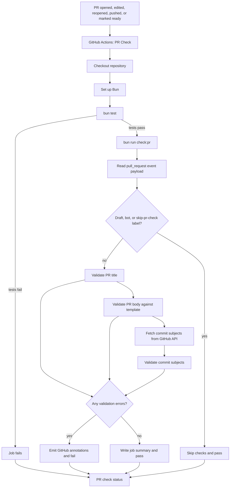

# check-pr

Bun-based pull request validator for OptEco. It enforces the repository's
[commit convention](../../AGENTS.md#commit-convention) and
[pull request template](../../.github/pull_request_template.md) in CI, and can
also be run locally.

## Files

| Path | Purpose |
|---|---|
| `index.ts` | Entry point, validation functions, and GitHub event handling |
| `index.test.ts` | Unit tests for the pure validation functions |
| `../../.github/workflows/pr-check.yml` | GitHub Actions workflow that runs the tests and validator |
| `../../package.json` | `bun test` and `bun run check:pr` scripts |

## Flow



## Architecture

The validator is split into pure functions and a small orchestration layer:

- **Pure validators** (`validateTitle`, `validateBody`,
  `validateCommitSubject`, `validateCommits`) contain no I/O. They are easy to
  unit test and are exported from `index.ts`.
- **`main()`** reads `GITHUB_EVENT_PATH`, applies bypass rules, fetches commit
  subjects, aggregates errors, writes the job summary, and returns an exit code.
- **`index.test.ts`** imports the pure validators directly. The
  `import.meta.main` guard in `index.ts` prevents `main()` from running during
  tests.
- **GitHub is the source of truth** for the PR title, body, labels, author type,
  and draft state. The event payload is used instead of parsing local files.
- **Commit subjects** are read from the pull request commits API. No local Git
  history is required.

## Validation rules

| Check | Rule |
|---|---|
| PR title | Conventional Commits, lowercase description, 72 characters or fewer |
| Required sections | Summary, Related issue, Type of change, What changed, How tested, Checklist |
| Related issue | Contains `Closes #123`, `Fixes #123`, or `Refs #123` |
| Type of change | At least one checkbox selected |
| How tested | At least one checkbox selected |
| Checklist | Every checkbox checked |
| Commit subjects | Conventional Commits; merge and GitHub revert commits are exempt |
| Bypass | Draft PRs, bot authors, or the `skip-pr-check` label |

HTML comments are stripped before checking section content, so placeholder
comments from the template do not satisfy a section.

## Running locally

Run the tests:

```bash
bun test
```

Run the validator without a GitHub event:

```bash
PR_TITLE="docs: update readme" \
PR_BODY="$(cat /tmp/pr-body.md)" \
PR_COMMITS="docs: update readme" \
bun run check:pr
```

To exercise the event-payload path:

```bash
GITHUB_EVENT_PATH=/path/to/pull-request-event.json bun run check:pr
```

`GITHUB_TOKEN` is only required for commit subject checks. Without it, the
validator emits a warning and skips that part.

## Adding a rule

1. Add a pure validation function in `index.ts`.
2. Add focused cases to `index.test.ts`.
3. Add the function's errors to the aggregation in `main()`.
4. Update the PR template or this document if the rule changes contributor
   expectations.
5. Run `bun test` and `bun run check:pr`.

## CI details

- Workflow: `.github/workflows/pr-check.yml`
- Trigger: `opened`, `edited`, `reopened`, `synchronize`, `ready_for_review`
- Permissions: `contents: read`, `pull-requests: read`
- Concurrency: one run per PR; newer runs cancel older ones
- Output: GitHub annotations for each error and a job summary
