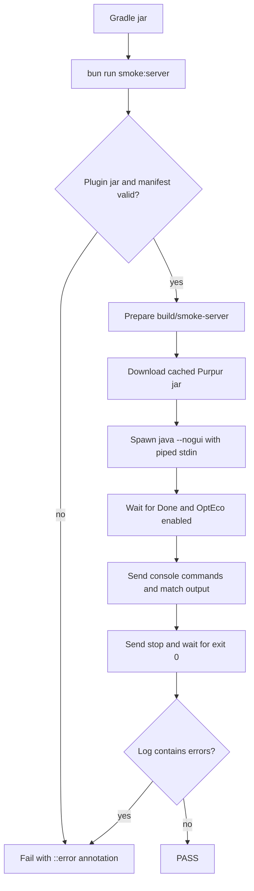

# smoke-server

Bun-based end-to-end smoke test for OptEco. It boots a real Purpur server,
installs the built plugin jar, types a handful of commands into the console, and
fails when the run is not clean.

This is deliberately **not** a unit test: it runs on the release artifact and
catches the problems MockBukkit cannot see — a broken shaded jar, an
incompatible server API, a bad `plugin.yml`, driver/class-loader conflicts or a
startup failure in the real plugin class loader.

## Usage

```bash
./gradlew jar
bun run smoke:server
```

Requirements: JDK 21 on `PATH`, Bun, and network access on the first run to
download the server jar. Windows, macOS and Linux all work.

| Variable | Default | Purpose |
|---|---|---|
| `MC_VERSION` | `1.20.4` | Purpur/Minecraft version to boot |
| `SERVER_DIR` | `build/smoke-server` | Throwaway server directory |
| `STARTUP_TIMEOUT` | `240` | Seconds to wait for `Done (` |
| `COMMAND_TIMEOUT` | `60` | Seconds to wait for each console answer |

## What it checks

1. `build/libs` contains a plugin jar and `plugin.yml` has a replaced version
   token (no `@VERSION@`).
2. The server jar downloads and boots with the plugin installed.
3. The plugin enables against SQLite and creates `account.sqlite` and the
   language file.
4. Console commands answer correctly: empty leaderboard, player-only rejection,
   missing-account error, configuration reload, unknown subcommand and help.
5. `stop` shuts the server down with exit code 0 and the log contains no
   `SEVERE`, `Could not load`, `Error occurred` or similar errors.

## Flow



## Notes

- The server runs offline: update checks and bStats are disabled in the seeded
  config, and `online-mode=false` avoids Mojang session calls.
- ANSI colour codes are stripped from the in-memory line buffer before matching,
  and `terminal.ansi=false` keeps the uploaded log readable.
- The downloaded jar is cached in `build/cache/`, so repeated runs only pay for
  server startup.
- CI runs this from `.github/workflows/server-smoke.yml` weekly, on `v*` tags and
  on demand. It is not a pull-request gate because it needs a network download
  and roughly one minute of wall time.
